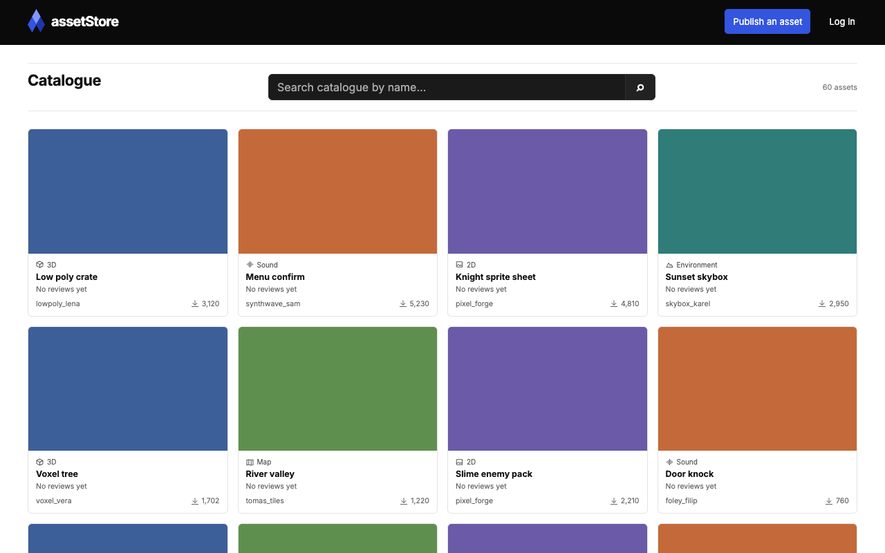
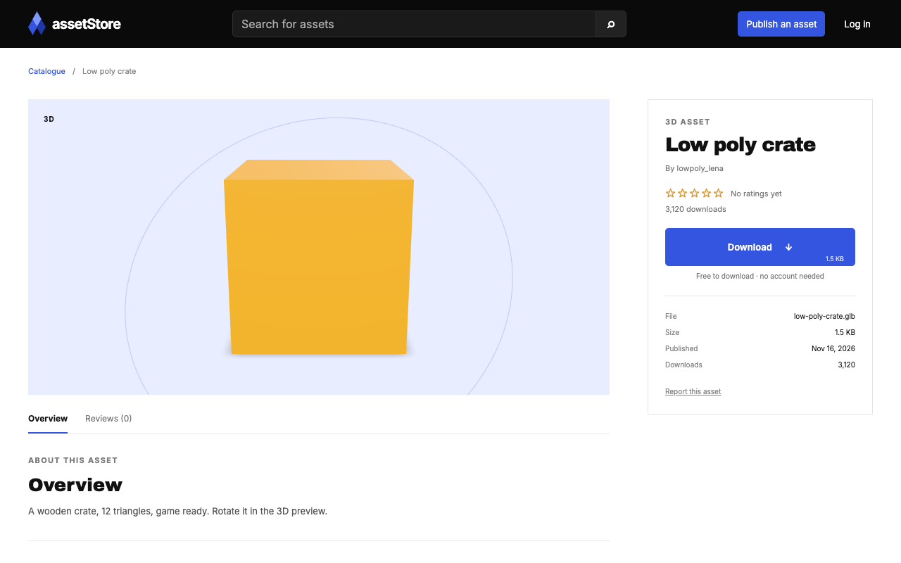
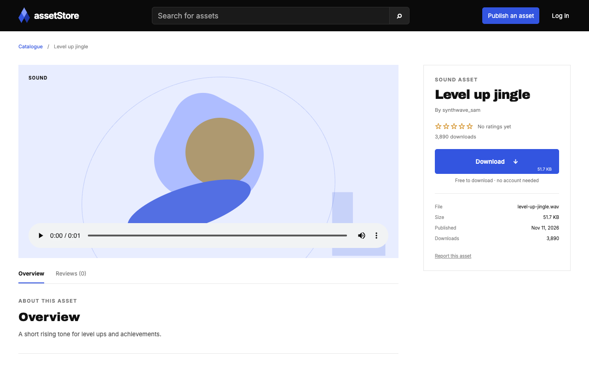
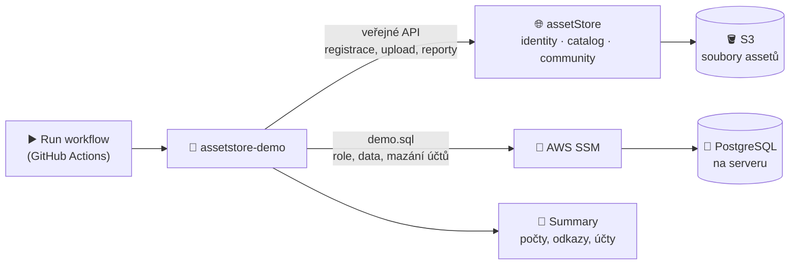

<div align="center">

# 🎛️ assetStore-demo

**Jedním tlačítkem naplní [assetStore](https://github.com/Unicorn-University-Team/assetStore) realistickými daty
a stejně snadno je zase uklidí.**

[](https://github.com/Unicorn-University-Team/assetStore-demo/actions/workflows/ci.yml)
[](https://github.com/Unicorn-University-Team/assetStore-demo/actions/workflows/demo-data.yml)


[](https://3-125-15-78.sslip.io)



</div>

## ✨ Co to umí

- 👥 **12 demo účtů:** autoři, běžní uživatelé, admin a zablokovaný účet. Každý ukazuje jinou část webu.
- 📦 **59 assetů se skutečnými soubory a obrázkem náhledu**, generovanými v kódu:

  | Formát | Obsah |
  |---|---|
  | PNG | obrázky |
  | GLB | 3D modely, jdou otočit v náhledu |
  | WAV | zvuky |
  | TMX | mapy pro Tiled |
  | ZIP | skyboxy |
- 🏷️ **Tagy u assetů** (`pixel-art`, `low-poly`, `sfx`, `skybox`…): `seed` chybějící tagy vytvoří a doplní je i u dřív nahraných assetů (stejně tak chybějící obrázek náhledu). `wipe` tagy nechá, jsou společné pro všechny.
- 🚩 **10 reportů**: část čeká v adminské frontě, část je zamítnutá.
- ♻️ **Idempotentní:** opakovaný `seed` nic nezdvojí, `wipe` smaže jen demo data a nic jiného.
- 🩺 **Každé ráno kontrola**, že web běží a ukázkové assety jdou otevřít. Když ne, přijde e-mail.
- 🪶 **Na serveru nic neběží:** nástroj mluví jen s veřejným API webu, spouští se z GitHub Actions.

<table>
  <tr>
    <td></td>
    <td></td>
  </tr>
  <tr>
    <td align="center">🧊 3D model se dá otočit myší</td>
    <td align="center">🔊 zvuk se dá přehrát a přetočit</td>
  </tr>
</table>

## 🎛️ Ovládací panel

**[▶️ Actions → Demo data → Run workflow](https://github.com/Unicorn-University-Team/assetStore-demo/actions/workflows/demo-data.yml)**

| Příkaz | Co udělá | Mění data |
|---|---|:---:|
| 📊 `status` | Kolik je demo účtů a assetů, odkazy na ukázky. | ne |
| 🩺 `check` | Jako `status` + ověří, že ukázkové assety jdou otevřít (detail i náhled). Při problému běh selže. | ne |
| 🌱 `seed` | Vytvoří nebo doplní demo data. Na konci je automaticky zkontroluje. | ano |
| ♻️ `reset` | `wipe` a hned `seed`: čistý demo stav. Chce potvrzení `SMAZAT`. | ano |
| 🧹 `wipe` | Smaže demo data: assety i soubory v S3, reporty, účty. Chce potvrzení `SMAZAT`. | ano |

- 🧪 **dry_run** jen ukáže, co by se stalo.
- 🔒 `wipe` a `reset` bez napsaného `SMAZAT` nic nesmažou.
- **Výsledek** je v **Summary** běhu:
  - počty;
  - odkazy na 3D model, zvuk, obrázek a mapu;
  - seznam demo účtů.
- Heslo se nikde nevypisuje.

## 🔑 Demo účty

Heslo všech účtů je v secretu `DEMO_PASSWORD` (zná ho Yura). Přihlášení: <https://3-125-15-78.sslip.io/login>

| E-mail | Co ukazuje |
|---|---|
| `pixel.forge@demo.assetstore.test` | Autor s 22 assety: 2 stránky v „My assets“. |
| `lowpoly.lena@demo.assetstore.test` | Autorka 3D modelů. |
| `curious.eva@demo.assetstore.test` | Běžná uživatelka bez assetů, posílá reporty. |
| `demo.admin@demo.assetstore.test` | Admin: fronta reportů v `/admin/reports`. |
| `demo.suspended@demo.assetstore.test` | Zablokovaný účet: přihlášení odmítne. |

Ostatní (`tomas.tiles`, `synthwave.sam`, `mapmaker.mira`, `foley.filip`, `voxel.vera`, `skybox.karel`, `jan.plays`)
vypíše Summary po každém `seed`.

## 🧭 Jak to funguje



1. **Přes API, kde to jde.** Data projdou stejnou validací a audit logem jako od uživatelů na webu.
2. **SQL jen na to, co API neumí:**
   - role admina;
   - zablokování účtu;
   - datum publikace;
   - počet stažení;
   - mazání účtů.

   Nástroj ho jen zapíše do souboru, workflow ho pošle přes SSM do kontejneru `db`. K databázi se nástroj nepřipojuje.
3. **AWS bez klíčů:** GitHub OIDC a role `assetstore-demo-github`. Smí ji použít jen `main` tohoto repa a umí jen
   poslat příkaz na náš server.

Podrobně: [docs/spec.md](docs/spec.md) · plán: [docs/plan.md](docs/plan.md)

## 💻 Lokálně

Potřeba je běžící assetStore (služby + `npm run dev` ve `frontend`, vite proxy `/api`) a buď Rust, nebo hotová binárka
z [Releases](https://github.com/Unicorn-University-Team/assetStore-demo/releases).

```bash
cp .env.example .env              # doplnit DEMO_PASSWORD (aspoň 8 znaků)
set -a; source .env; set +a

cargo run -- status               # 📊 kolik čeho je
cargo run -- seed --sql-out demo.sql
psql -v ON_ERROR_STOP=1 -f demo.sql    # role, data publikace, stažení
cargo run -- check                # 🩺 ověří ukázkové assety
cargo run -- wipe --sql-out wipe.sql && psql -v ON_ERROR_STOP=1 -f wipe.sql
```

Mimo `localhost` chtějí `seed` a `wipe` přepínač `--yes`. `--dry-run` nic nezmění.

## 🗂️ Struktura

```text
src/
├── main.rs             CLI: status · check · seed · wipe
├── api.rs              session s cookies nad veřejným API
├── seed.rs  wipe.rs    vytvoření a smazání demo dat
├── status.rs           status a check
├── files.rs            PNG, WAV, GLB, ZIP, TMX bez závislostí
├── sql.rs              SQL soubor pro to, co API neumí
├── summary.rs          výstup do terminálu a GitHub Summary
└── fixtures/           ručně psaní uživatelé, assety, reporty
.github/workflows/
├── ci.yml              formát, clippy, testy, velikost binárky
├── demo-data.yml       🎛️ ovládací panel + denní kontrola
└── release.yml         tag v* → binárky pro Linux a macOS
aws/setup-demo-role.sh  jednorázové nastavení role v AWS
```

## ❓ FAQ

<details><summary><b>Je bezpečné pouštět to na produkci?</b></summary>

- `wipe` maže jen účty v doméně `@demo.assetstore.test` a jejich assety.
- Mimo localhost nástroj bez `--yes` nic nezmění.
- Workflow navíc chce u mazání napsané `SMAZAT`.

</details>

<details><summary><b>Kolik to zabere místa?</b></summary>

Soubory všech demo assetů mají dohromady pod 10 MB a leží v S3. Na disk serveru nejde nic. Nástroj se staví na
runneru GitHubu, ne na našem serveru.

</details>

<details><summary><b>Co když se změní API assetStore?</b></summary>

Ranní `check` selže a přijde e-mail. Chyba ukáže endpoint i odpověď serveru.

</details>

<details><summary><b>Proč Rust?</b></summary>

Jedna malá binárka (~2 MB) bez Node a bez Dockeru. Rychle se spustí v Actions a nic neinstaluje na server.

</details>

<details><summary><b>Jak přidat další demo data?</b></summary>

Do `src/fixtures/`:
- asset do `assets.rs`;
- report do `reports.rs`.

Testy hlídají pravidla catalogu: typ, příponu, délku názvu a popisu, velikost. Až backend přidá tagy nebo recenze,
přibude nový modul.

</details>

## 🛠️ Vývoj

```bash
cargo fmt && cargo clippy --all-targets -- -D warnings && cargo test
```

- **Změny:** každá změna = vlastní větev a PR (česky), commity anglicky, merguje Yura.
- **Release:** `git tag v0.2.0 && git push --tags`.
